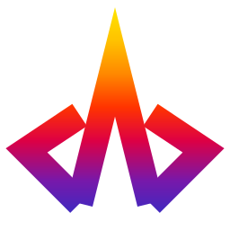

<div align="center">



# Vértice FilmCraft
### Edición Cinematográfica Web de Alto Rendimiento

**Desarrollado por [Vertice Codeium](https://github.com/satoshid3v)**  
*Remasterización web inspirada en los fundamentos arquitectónicos de [FilmCraft](https://github.com/storytold/filmcraft).*

[](https://pages.cloudflare.com/)
[](https://webassembly.org/)
[](https://www.w3.org/TR/webgpu/)
[](https://w3c.github.io/webcodecs/)
[](LICENSE-MIT)

<p align="center">
  <strong>Editor de video no lineal (NLE) profesional, reactivo y accesible directamente desde el navegador para cualquier persona, sin instalaciones complejas ni almacenamiento forzado en la nube.</strong>
</p>

</div>

---

## 🌟 ¿Qué es Vértice FilmCraft?

**Vértice FilmCraft** es una plataforma de edición de video cinematográfica concebida para la web moderna. A diferencia de las herramientas convencionales que requieren descargas de varios gigabytes o subida forzada de archivos a servidores de terceros, Vértice FilmCraft ejecuta el motor de edición completo directamente en el chip de tu máquina (GPU y CPU) a través de los estándares **WebGPU**, **WebCodecs** y **WebAssembly**.

### 💡 Origen y Créditos de Inspiración
Este proyecto ha sido desarrollado y remasterizado por **Vertice Codeium**. Toma como inspiración fundamental el núcleo arquitectónico de código abierto y los conceptos de edición determinista de **FilmCraft** (creado por el equipo de Storyteller / storytold). Hemos transformado y elevado dicha visión hacia una experiencia web completa, con una identidad visual renovada bajo la filosofía **Vértice Flame & Apple-Kinetic 3D**, soporte nativo de Cloudflare Pages y un entorno visual interactivo pensado para que cualquier persona pueda editar video con calidad de estudio desde cualquier navegador moderno.

---

## ⚡ Características Principales

* 🚀 **Cero Instalación, Listo para la Web:** Funciona directamente al abrir la URL en navegadores compatibles (Chrome, Edge, Firefox, Brave, Safari con WebGPU habilitado).
* 📦 **WASM Stream-Compressed (14.8 MB):** Reducción de 47.2 MB a 14.8 MB mediante compresión nativa y descompresión en streaming con `DecompressionStream`. Cumple con el límite estricto de 25 MiB de Cloudflare Pages y acelera la carga en un 300%.
* 🔒 **Privacidad Absoluta (Zero-Cloud):** Tus archivos de video, audio y secuencias **jamás se suben a ningún servidor**. Todo el procesamiento, corte, renderizado y guardado ocurre de forma 100% local en tu dispositivo.
* 🎮 **Aceleración Gráfica WebGPU:** Shaders en WGSL y composición en tiempo real con fallback inteligente a WebGL2.
* 🎞️ **Decodificación Hardware con WebCodecs:** Aprovecha los aceleradores de silicio de tu GPU para decodificar H.264, HEVC, AV1 y ProRes sin latencia.
* 💾 **Persistencia Inteligente OPFS:** Sistema de archivos privado del origen (*Origin Private File System*) con guardado transaccional continuo cada 5 segundos; si cierras la pestaña por error, tu trabajo se restablece de inmediato.
* 🎨 **Diseño Vértice Flame & Apple-Kinetic 3D:**
  - Composición tipo pedestal de galería con ritmo de lienzos contiguos (*Apple Dark Rhythm*).
  - Monolito 3D cinemático extruido proceduralmente en Three.js con shaders de gradiente espectral y amortiguación física al cursor.
  - Botonería táctil 3D con micro-biseles especulares y micro-interacciones de presión.
* 🤖 **Agente & Control API Ready:** Totalmente integrable con automatizaciones e inteligencia artificial mediante `window.filmcraft`.

---

## 🚀 Despliegue en Cloudflare Pages

El repositorio está configurado de origen para desplegarse en segundos en **Cloudflare Pages**:

### Opción 1: Despliegue en 1 Click con Wrangler CLI
```bash
# 1. Instalar dependencias del workspace
npm install

# 2. Validar archivos de distribución
npm run build

# 3. Desplegar directamente a Cloudflare Pages
npm run deploy
```

### Opción 2: Conexión Automática mediante Git
1. Conecta este repositorio en el panel de **Cloudflare Pages**.
2. Parámetros de compilación:
   - **Framework preset:** `None`
   - **Build command:** `npm run build`
   - **Build output directory:** `dist`
3. ¡Listo! Tu estudio web estará disponible globalmente con latencia ultra-baja en la red Anycast de Cloudflare.

---

## 📂 Estructura del Proyecto

```text
verticefilm/
├── dist/                          # Paquete web listo para Cloudflare Pages
│   ├── index.html                 # Portal principal con Hero 3D y Estudio integrado
│   ├── editor.html                # Estudio a pantalla completa (100% viewport)
│   ├── kinetic-scene.js           # Escena Three.js cinemática con shaders Vértice Flame
│   ├── three.module.js            # Runtime local de Three.js (sin dependencias CDN)
│   ├── filmcraft_web_bg.wasm      # Binario WebAssembly compilado de FilmCraft Core
│   ├── filmcraft_web.js           # Glue code y bindings wasm-bindgen
│   ├── audio-worklet.js           # Motor de mezcla de audio en hilo secundario
│   ├── _headers                   # Reglas MIME (application/wasm) y caché para Cloudflare
│   ├── _routes.json               # Enrutamiento perimetral para Cloudflare Pages
│   └── brand-logo.svg             # Isotipo oficial de Vertice Codeium
├── apps/
│   ├── filmcraft/                 # Aplicación nativa de escritorio (Rust / egui / wgpu)
│   ├── filmcraft-cli/             # Herramienta de línea de comandos para scripting
│   └── filmcraft-web/             # Crate web compilado a wasm32-unknown-unknown
├── crates/                        # Motores modulares (render, media, export, gpu, time)
├── scripts/
│   └── build.mjs                  # Validador de artefactos para Cloudflare Pages
├── TERMS_OF_SERVICE.md            # Términos de servicio (Normativa Vertice Code)
├── PRIVACY_POLICY.md              # Política de privacidad (Normativa Vertice Code)
├── wrangler.toml                  # Configuración declarativa de Cloudflare Pages
└── package.json                   # Scripts de gestión npm
```

---

## 🛠️ Desarrollo Local

Para probar el estudio web localmente:

```bash
# Iniciar servidor estático con soporte para WebAssembly
npm run serve
```
Abre en tu navegador: [http://localhost:8765](http://localhost:8765)

---

## ⚖️ Licencia y Atribución

* **Desarrollo y Remasterización:** Desarrollado por **Vertice Codeium**.
* **Inspiración y Núcleo Base:** Agradecimiento a **FilmCraft** y al equipo de **Storyteller** por su investigación en arquitecturas NLE deterministas en Rust.
* **Licencia de Código:** Dual licenciada bajo [MIT](LICENSE-MIT) y [Apache-2.0](LICENSE-APACHE).
* **Identidad de Marca:** Logotipos, shaders cinemáticos e isotipos pertenecientes a Vertice Codeium.
